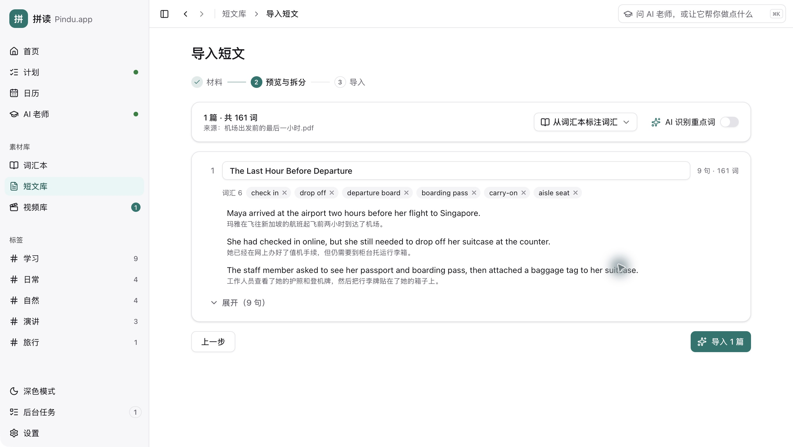
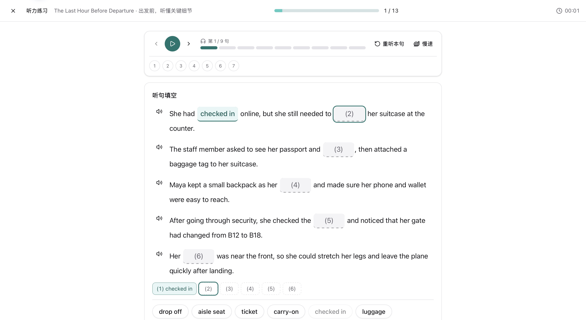
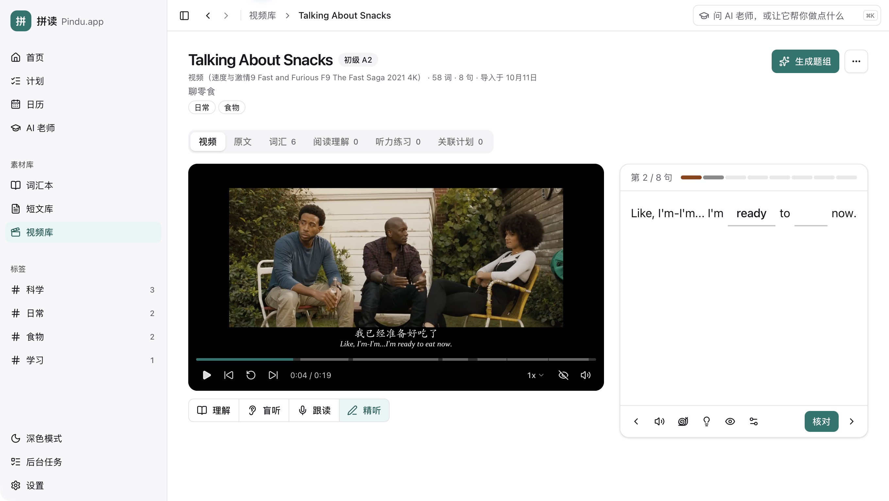
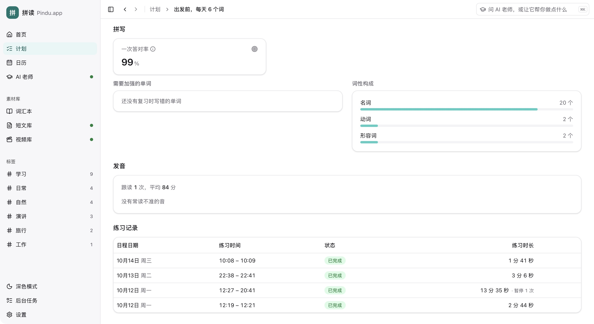
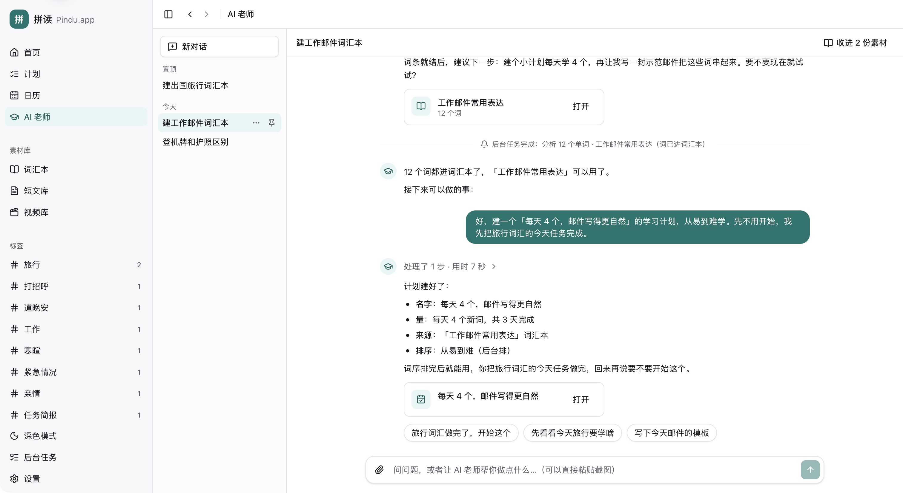
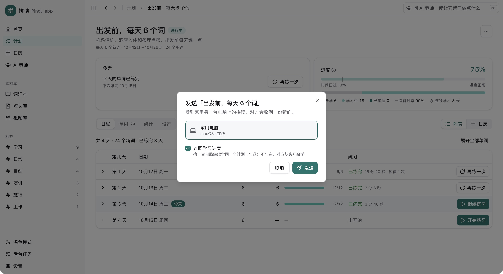

# Pindu.app (拼读)

[中文](./README.md) · [Install](./INSTALL.md) · [Security & privacy](./SECURITY.md)

**Turn the English around you into resources you can study, practise and review every day.**

Pindu is a desktop English learning tool that turns text, documents, local videos and subtitles into study materials for vocabulary, reading, listening, spelling, shadowing and review.

Available for macOS and Windows. No account is required. See [usage costs](#usage-costs) for fees and the [installation guide](./INSTALL.md) (Chinese) for setup.

> The user interface is currently available in Simplified Chinese only.

The home page brings together daily tasks, study plans and learning progress, with a shortcut to resume unfinished practice.

## Features

### Vocabulary and phonics

Manage words and phrases, extract vocabulary from text, documents and images, or generate it for your learning needs. Word cards provide IPA, syllables, phonics, meanings and graded example sentences.

### Document import and reading

Import text, PDFs, Word files or images. Keep the original text and existing translations while adding sentence translations and vocabulary. Preview and edit the content before importing.

The reader supports sentence playback and shadowing, listening with the text hidden, vocabulary recall, word lookup and adding selected words. Generate practice passages from vocabulary or topics, and adjust the reading voice, style and speed.

Sentence analysis explains sentence patterns, constituents, grammar, phrases and pronunciation, with an option to ask the AI tutor follow-up questions.

### Reading and listening exercises

Create separate reading and listening question sets for each passage, with cloze, multiple-choice, true/false and open questions, scores and feedback. Listening practice supports sentence replay and slower playback.

### Video learning

Import local videos with automatically detected external or embedded subtitles. If English subtitles are missing, speech can be transcribed on your computer. Create bilingual dialogue and scene clips, with previews, clip range adjustments, subtitle reorganization and timing corrections in the editor. Videos up to five minutes long can become a single scene clip.

Scene clips offer four practice modes: understand (an AI teacher walks through the clip section by section), blind listening (optionally with the picture hidden), speaking (sentence-by-sentence with pronunciation scoring, or shadowing along with the original audio) and intensive listening (fill in key words sentence by sentence). Passage playback and listening questions can use the original video audio or AI-generated speech.

### Study plans and review

Add vocabulary books, passages and scene clips to study plans. Set your daily workload and learning order, with daily tasks and spaced vocabulary review scheduled automatically.

Vocabulary practice combines speaking, spelling and recall, followed by a short quiz. Pronunciation feedback highlights sounds to improve, and progress is saved so you can resume unfinished practice.

Learning statistics show words studied and mastered, first-attempt accuracy, study time and your learning streak. Each plan has separate results for spelling, pronunciation, reading and listening.

### AI tutor

Get explanations of words, usage and sentences based on your materials and progress. The tutor can also create vocabulary books, passages, question sets and study plans on request. Ask about a whole passage or clip directly from the reader or clip guide. Search or pin conversations, continue asking questions, or start a new conversation from one of your earlier messages. Voice input is supported.

### Transfer between computers

Pair computers on the same network to send vocabulary books, passages, videos, scene clips and study plans. Plans can include learning progress so you can continue studying on another computer.

## Usage costs

**Pindu is completely free and open source**, under the [MIT license](./LICENSE). There are no software usage or membership subscription fees.

- **AI models**: choose your own provider and model, configure your own API key, and pay the provider directly for usage.
- **Speech**: text-to-speech uses the service you configure, with fees charged by that provider under its own terms.

Your costs depend on the model, speech service and usage, as shown in the provider's pricing and billing. Pindu does not collect these fees or include AI or speech credits. Manual vocabulary management, practice and statistics work without configuring these services.

Local subtitle transcription, pronunciation scoring and voice input do not require a paid online speech service. Original video audio also works without a text-to-speech service.

## Installation

Download the installer for your system from [Releases](https://github.com/abbish/pindu/releases):

| System | Installer |
|---|---|
| macOS | `.dmg` |
| Windows | `-setup.exe` |

Requires macOS 10.15 or later, or Windows 10 or later. Pronunciation scoring and voice input need macOS 13.4 or later (macOS 14 or later on Apple silicon Macs); Windows is not affected.

Your system may ask for confirmation the first time you open the app; see the [installation guide](./INSTALL.md#1-下载安装包) (Chinese) for the steps. You can install later versions through in-app updates.

After installation, configure these services in Settings:

- **AI models**: any OpenAI-compatible endpoint. OpenRouter, MiniMax, Moonshot and DeepSeek are preset.
- **Speech**: Volcengine Doubao TTS.

Without them, you can still manage vocabulary books by hand, practise and view statistics.

Subtitle transcription, pronunciation scoring and voice input require local models, which you can manage in Settings → Local models.

## Privacy

- Your learning materials and records, including AI tutor conversations, are stored on your computer. There is no usage tracking.
- When you use AI or text-to-speech, the relevant content is sent directly to the provider you configured.
- Subtitle transcription, pronunciation scoring and voice input run locally. Video audio and recordings are not sent to those providers.
- Local model downloads and update checks require a network connection. You can turn off automatic update checks in Settings.
- Transfers take place on the same local network. Materials and any learning progress you choose to include are sent only to the selected paired computer.
- Service keys (API keys) are stored on your computer without encryption and are never written to logs.

See [SECURITY.md](./SECURITY.md) for details.

## Help and feedback

For setup, service configuration, updates and backups, see the [installation and usage guide](./INSTALL.md) (Chinese). Report problems in [Issues](https://github.com/abbish/pindu/issues), including your operating system, the steps you took and what happened.

## License

[MIT](./LICENSE) © 2023-2026 abbish and RedLark contributors

See the [third-party license notices](./src-tauri/licenses/THIRD_PARTY_NOTICES.md).
