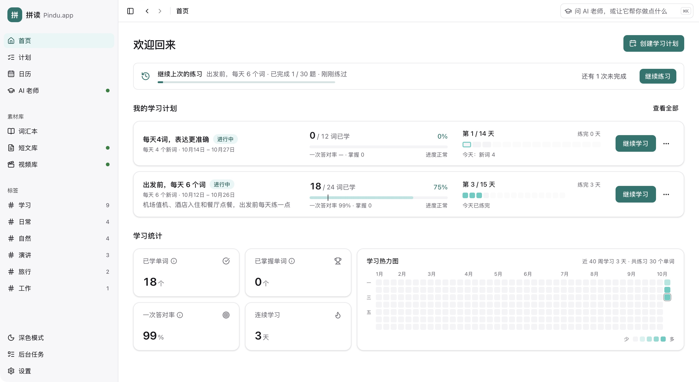
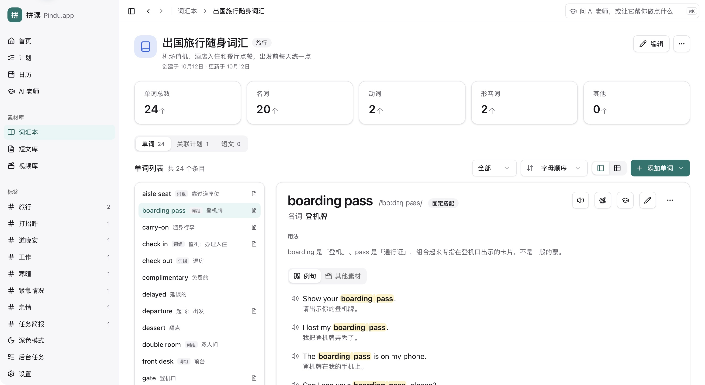
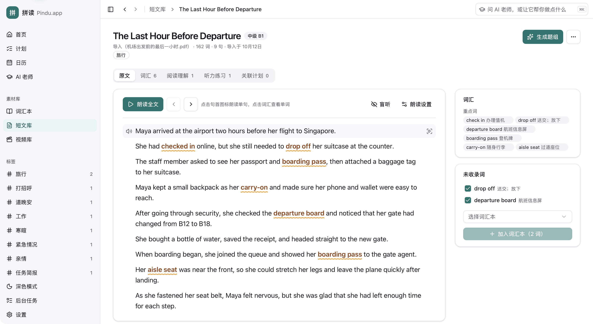
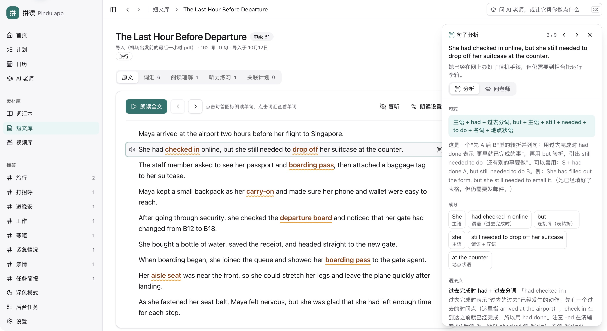
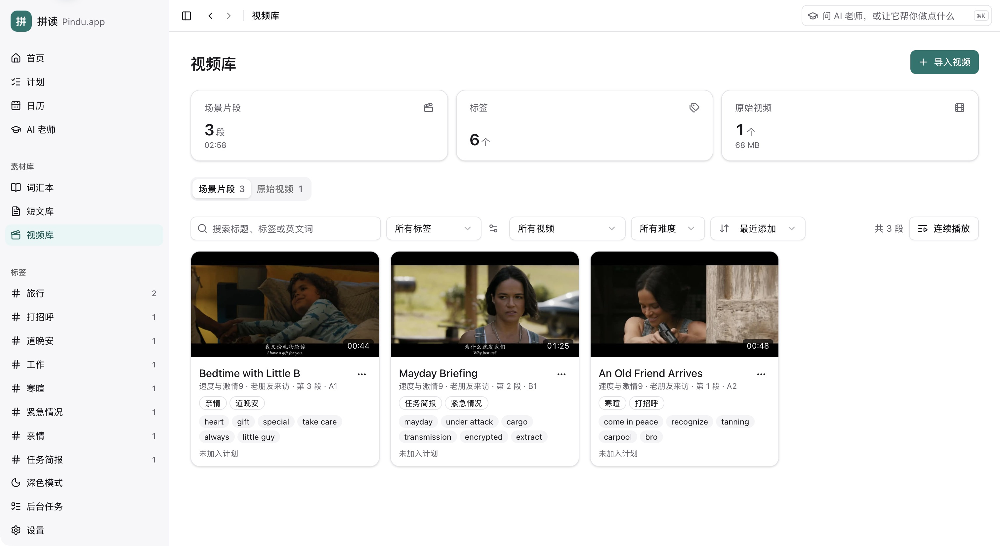
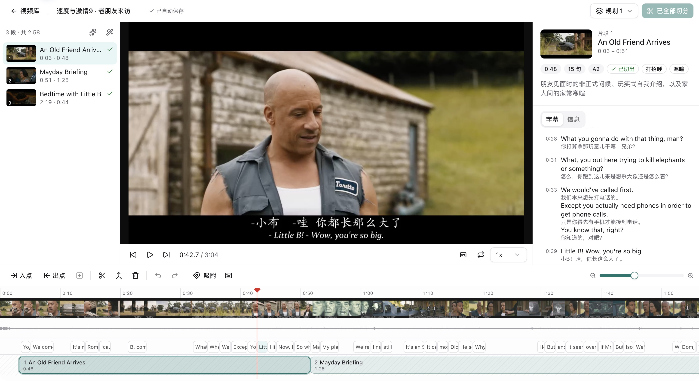
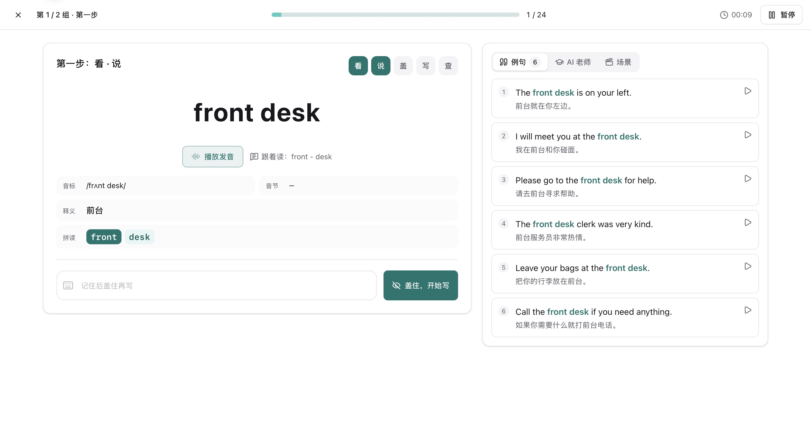
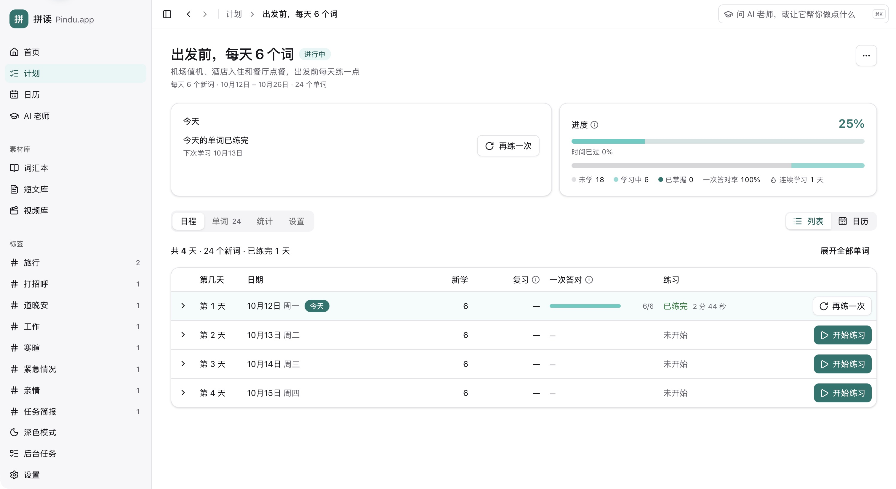
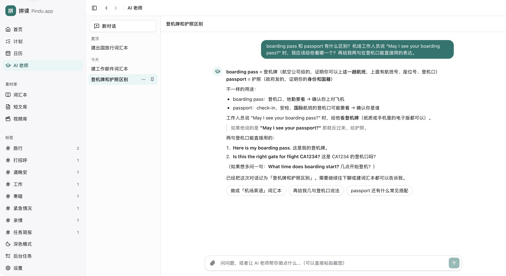

# Pindu.app (拼读)

[中文](./README.md) · [Install](./INSTALL.md) · [Security & privacy](./SECURITY.md)

**Turn the English around you into resources you can study, practise and review every day.**

Course readings, documents you need at work and videos you want to understand can all be starting points for learning English.

Pindu is a desktop English learning tool that helps you turn these materials into vocabulary, passages and scene clips. Practise reading, listening, spelling and shadowing, then keep learning each day with study plans and review.

- **Learn English that matters to you**: start with content you want to read, understand or use, and choose the words and phrases worth learning.
- **Turn materials into learning resources**: import text, documents or local videos with subtitles, and add translations, vocabulary notes and exercises.
- **Keep learning over time**: add vocabulary, passages and scene clips to a plan with daily tasks and vocabulary review.

Available for macOS, Windows and Linux. No account is required. See [usage costs](#usage-costs) for fees and the [installation guide](./INSTALL.md) (Chinese) for setup and service configuration.

> The user interface is currently available in Simplified Chinese only.

## Features

### Vocabulary books

Build vocabulary books from words and phrases you encounter in your own materials and want to learn or use.

- Entries can be single words or phrases (phrasal verbs, collocations, idioms, fixed expressions). Phrases are marked as separable or not.
- Ways to add entries:
  - Extract new words and phrases from text, subtitles or documents (txt, md, srt, vtt, docx, pdf).
  - Type them in by hand and auto-fill the details with AI.
  - Generate additional vocabulary from the book's scene description, with vocabulary topic suggestions to choose from.
- Entry details include IPA, syllables, phonics chunks, meanings and graded example sentences.
- Vocabulary books, passages and videos share tags. The sidebar groups related material by tag.

### Passages

Import articles, course readings or work documents and study words and phrases in the original text.

- When you import English material, the original text is kept unchanged. Only translations, a title, a level and key words are added.
- While reading:
  - Vocabulary words are highlighted, and clicking one opens its word card.
  - Passages can be played sentence by sentence or listened to with the text hidden.
  - Any word or phrase you select in the text can be added to the vocabulary. Words can be removed, or re-picked by AI with conditions you set.
- The title, level and each sentence's translation can be edited.
- Sentence analysis: sentence pattern, constituents, grammar points, communicative function, useful phrases and pronunciation notes.
- Comprehension exercises:
  - Cloze, multiple-choice and true/false questions are graded automatically.
  - Open questions receive scores and suggestions for improvement.
- Passages can be added to study plans at a fixed interval.
- When you need more practice material, generate passages from vocabulary books, words in study plans or a topic description, with sentence-by-sentence translations.

### Video library

Cut videos you want to understand into scene clips you can study repeatedly, using their dialogue for listening and shadowing practice.

- Import a local video with its subtitles to organize and translate the subtitles and get a proposed plan for cutting the video into scenes.
- In the clip editor you can preview clips, adjust in and out points and correct the subtitle timing. Clips are cut precisely once you confirm the plan.
- Each scene clip can be studied in three ways: line-by-line study, shadowing with recording, and listen-and-spell. Scene clips can be added to study plans.
- Searching for an English word finds every scene clip in which it is spoken.
- Video processing needs no additional software installation.

### Study plans and practice

Add vocabulary books, passages and scene clips to a study plan so each day has specific material to learn.

- Choose vocabulary books and a daily number of new words, and the schedule is arranged automatically. Plans can be paused; the schedule shifts when you resume.
- New words are practised in three steps:
  1. Full information.
  2. English hidden; spell from memory.
  3. Chinese meaning, syllables and pronunciation only.
- Vocabulary reviews follow a memory level with intervals of 1, 3, 7, 14 and 30 days. A correct answer moves the word up a level and a mistake sends it back to the first. Reviews that are due are added to the day's tasks automatically.
- Passages and scene clips can also be scheduled as reading or listening tasks.

### AI tutor

Ask about words, usage or sentences you do not understand as you study, and follow up with more questions.

- Word cards offer explanations of meanings, spelling patterns, related words, usage, commonly confused words and memory aids.
- The depth of explanations follows the learner profile (primary school, secondary school or adult).
- Sentences in passages and scene clips can also be discussed with the tutor.

### Speech

- 15 English voices are built in. Words and sentences are always read in English, including numbers and dates.
- Sentence reading styles: teacher, natural, storytelling, news or a custom instruction. Speed, pitch and volume are adjustable.
- Previously generated audio can be reused when you play the same content again, reducing repeated generation.

## Usage costs

**Pindu is completely free and open source**, under the [MIT license](./LICENSE). There are no software usage or membership subscription fees.

- **AI models**: choose your own provider and model, configure your own API key, and pay the provider directly for usage.
- **Speech**: text-to-speech uses the service you configure, with fees charged by that provider under its own terms.

Your costs depend on the model, speech service and usage, as shown in the provider's pricing and billing. Pindu does not collect these fees or include AI or speech credits. Manual vocabulary management, practice and statistics work without configuring these services.

## Installation

Download the installer for your system from [Releases](https://github.com/abbish/pindu/releases):

| System | Installer |
|---|---|
| macOS | `.dmg` |
| Windows | `-setup.exe` |
| Linux | AppImage, deb or rpm |

Your system may ask for confirmation the first time you open the app; see the [installation guide](./INSTALL.md#1-下载安装包) (Chinese) for the steps. You can install later versions through in-app updates.

After installation, configure these services in Settings:

- **AI models**: any OpenAI-compatible endpoint. OpenRouter, MiniMax, Moonshot and DeepSeek are preset.
- **Speech**: Volcengine Doubao TTS.

Without them, you can still manage vocabulary books by hand, practise and view statistics.

## Privacy

- Your learning materials and records are stored on your computer. There is no usage tracking.
- The app connects to the network in two cases only:
  - When you use AI or speech features, the relevant content is sent directly to the provider you configured.
  - When it checks GitHub for updates. You can turn this off in Settings.
- Service keys (API keys) are stored on your computer without encryption and are never written to logs.

See [SECURITY.md](./SECURITY.md) for details.

## Help and feedback

For setup, service configuration, updates and backups, see the [installation and usage guide](./INSTALL.md) (Chinese). Report problems in [Issues](https://github.com/abbish/pindu/issues), including your operating system, the steps you took and what happened.

## License

[MIT](./LICENSE) © 2023-2026 abbish and RedLark contributors

See the [third-party license notices](./src-tauri/licenses/THIRD_PARTY_NOTICES.md).

Screenshots use demo data. Video frames are from *Tears of Steel* (© Blender Foundation, [CC BY 3.0](https://creativecommons.org/licenses/by/3.0/), [mango.blender.org](https://mango.blender.org)).
